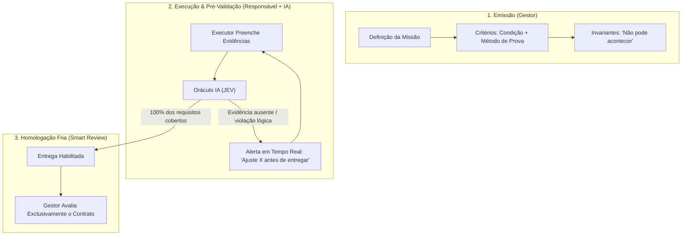

# Análise de Engenharia: Prevenção de Recusas, Ambiguidade e Verificação de 100% de Atendimento em Folhas de Tarefa

> **Documento de Pesquisa, Lições Reais e Recomendações de Arquitetura**  
> **Para avaliação por:** Modelos de Linguagem (JEV, Agentes de Arquitetura), Gestores de Projeto e Desenvolvedores.  
> **Data:** 18/10/2026  
> **Workspace:** `tarefas-build` (Aplicativo de Missões / Protocolo de Missões)  
> **Arquivo base:** [docs/protocolo_missoes.md](file:///c:/Users/andre/Documents/Sistemas/tarefas-build/docs/protocolo_missoes.md) e [docs/proposta_jev.md](file:///c:/Users/andre/Documents/Sistemas/tarefas-build/docs/proposta_jev.md)

---

## 1. Motivação e Escopo

Em equipes de alta produtividade e em sistemas modernos de micro-tarefas digitais, o maior foco de desgaste, custo e desmotivação ocorre quando:
1. **O executor gasta horas de trabalho acreditando ter cumprido a solicitação, mas a entrega é rejeitada ou considerada "incompleta".**
2. **O demandante/gestor se frustra ao receber algo diferente do imaginado, acusando falta de atenção.**
3. **A revisão depende de humor e interpretação subjetiva:** sem um contrato lógico verificável, o "100% atendido" torna-se uma meta móvel (*moving target*).

Este estudo compila:
* Relatos empíricos de trabalhadores e solicitantes em fóruns reais (Reddit r/mturk, academic research on crowd-work rejections, comunidades de Web3 bounties).
* Paradigmas de verificação automatizada (*Smart Contracts* lógicos, Oráculos de Execução e *Definition of Done* programável).
* Propostas concretas de evolução para a **Folha de Missão** e para o **JEV (Avaliador de IA)** deste workspace.

---

## 2. Anatomia de Casos Reais: Por que Tarefas São Rejeitadas Injustamente?

Investigações de disputas em plataformas de tarefas revelam quatro causas-raiz estruturais para entregas reprovadas ou não remuneradas:

### 2.1. O "Requisito Não Escrito" (*The Unspoken Expectation*)
* **Cenário Real:** O solicitante pede: *"Resuma os 5 principais pontos do documento X"*. O executor entrega 5 tópicos analíticos impecáveis. O solicitante rejeita ou exige retrabalho porque queria *"no máximo 2 frases por tópico e com as fontes citadas em formato ABNT"*, mas **não havia escrito essa restrição na instrução**.
* **Patologia:** O solicitante tinha uma imagem mental pronta do resultado, mas só transcreveu o objetivo genérico. A reprovação ocorre por quebra de um contrato que nunca existiu no papel.

### 2.2. A Falácia da Entrega "Quase Certa" (*Binary All-or-Nothing Trap*)
* **Cenário Real:** Uma tarefa possui 4 entregáveis. O trabalhador executa com perfeição 3 deles, mas o 4º item possuía uma ambiguidade de nomenclatura técnica. O solicitante reprova a entrega inteira como "Não Atendida". O trabalhador sente-se lesado por ter gerado 75% do valor sem reconhecimento algum.
* **Patologia:** Falta de decomposição atômica e ausência de critérios de aceitação parciais (*graceful degradation*).

### 2.3. O Enigma do "Formato Livre" (*Open-ended Text Ambiguity*)
* **Cenário Real:** Tarefas com campos abertos como *"Descreva a solução encontrada"*. Um executor escreve um parágrafo denso; outro coloca um link para uma planilha; um terceiro cola uma linha de log. O avaliador rejeita os dois primeiros porque "precisava dos dados em tabela".
* **Patologia:** A folha não determinou o **formato da evidência** nem forneceu um *template/stub* de resposta.

### 2.4. A Armadilha da Checagem Oculta (*Trap / Trick Checks*)
* **Cenário Real:** Requisitos ambíguos inseridos no meio do texto que geram falsos-positivos na validação. Na pressa de avaliar, o gestor olha superficialmente e assume má-fé ou desatenção do operador.
* **Patologia:** Ausência de uma fase de alinhamento prévio (*Backbrief*) que denuncie o desacordo antes que o tempo seja gasto.

---

## 3. Conceito: A Tarefa como um "Smart Contract" Lógico

No ecossistema de contratos inteligentes (Ethereum, Algorand) e oráculos descentralizados (Chainlink), uma transação só é liquidada quando um conjunto inequívoco de pré-condições matemáticas e oraculares retorna `true`. 

Transpondo essa engenharia para a **Folha de Missão de uma equipe**, a folha deve funcionar como um **Contrato de Verificação Determinística**:

$$\text{Folha de Missão} = \langle \text{Intenção}, \text{Invariantes Invioláveis}, \text{Oráculos de Evidência}, \text{Função de Aceite} \rangle$$

### Como a IA avalia se a tarefa foi 100% atendida?
A Inteligência Artificial **não deve opinar subjetivamente** se "gostou" do trabalho. Ela atua como um **Oráculo de Integridade Contratual**:
1. **Completude Oracular:** Para cada critério de conclusão listado no cabeçalho, existe um link/evidência correspondente preenchido na entrega?
2. **Checagem de Invariantes Negativas:** O texto do resultado ou os dados fornecidos contradizem explicitamente qualquer cláusula do bloco *"Não pode acontecer"*?
3. **Consistência Semântica:** A evidência do tipo *"teste"* contém de fato dados de teste, ou é apenas uma declaração textual genérica?
4. **Isolamento de Escopo:** O gestor está tentando reprovar a entrega baseado em exigências que não faziam parte da versão da folha acordada? (Proteção do trabalhador contra *scope creep* na revisão).

---

## 4. Melhorias Recomendadas para a Folha de Tarefas do Workspace

Com base nessas descobertas, recomendamos as seguintes melhorias evolutivas para a interface e estrutura da folha ([public/tela-folha.js](file:///c:/Users/andre/Documents/Sistemas/tarefas-build/public/tela-folha.js) e [docs/protocolo_missoes.md](file:///c:/Users/andre/Documents/Sistemas/tarefas-build/docs/protocolo_missoes.md)):

### 4.1. Pareamento Rígido: Critério $\leftrightarrow$ Evidência
* **Hoje:** O cabeçalho traz critérios de conclusão e a entrega tem um campo de resultado geral e links soltos.
* **Melhoria na Folha:** Na seção de Entrega, renderizar **uma linha de comprovação para cada critério definido no cabeçalho**:
  - Exemplo:
    - *Critério 1:* "Resistência $> 20\text{ MPa}$ — verificado por teste" $\to$ **Campo:** [ Link da planilha de ruptura ] + [ Valor obtido: `____` MPa ]
    - *Critério 2:* "Sem fissuras visíveis — verificado por inspeção" $\to$ **Campo:** [ Anexo da foto / laudo ]
  - O botão de submissão só é liberado quando 100% dos critérios tiverem sua respectiva evidência declarada.

### 4.2. Inclusão de "Exemplos do Aceito" e "Anti-Exemplos" (Few-Shot na Folha)
* **Hoje:** Requisitos se dividem em *Precisa acontecer*, *Não pode acontecer* e *Consultar antes*.
* **Melhoria na Folha:** Permitir (ou incentivar via placeholder) a inclusão de **Anti-Exemplos** concretos em *Não pode acontecer*:
  - *Evita o clássico:* "Não entendi o que você considerava inaceitável".
  - *Exemplo prático:* Não pode: *"Usar dados de 2024 sem ajuste inflacionário (ex. de erro: usar tabela bruta do Bacen sem deflacionar pelo IPCA)"*.

### 4.3. Pré-Checagem Automática do JEV (*Pre-Flight Self-Check*)
* **Hoje:** O JEV é pensado para rodar no servidor em background após alterações.
* **Melhoria:** Antes do responsável clicar em "Entregar Missão", existe um botão **"Verificar com JEV"** (ou verificação passiva inline):
  - O JEV analisa a folha e emite uma mensagem neutra:
    > *"O critério 'curva de calibração' exige o método [análise], mas o campo de evidência aponta apenas uma observação de texto sem link para os dados. Recomenda-se anexar o link antes de submeter ao gestor."*
  - Isso resolve o problema antes que a entrega vire um "atrito pessoal" na mesa do gestor.

### 4.4. Regra de Proteção do Executor na Revisão (*Anti-Scope-Creep*)
* **Problema Real:** O gestor revisa a entrega e diz: *"Ficou bom, mas esqueci de avisar que precisava também do gráfico em pizza. Refaça."* O trabalhador perde horas extras de graça.
* **Diretriz de Protocolo:**
  - Se a entrega atende estritamente ao que estava escrito na versão da folha sob a qual ela foi executada, **a missão é considerada 100% Concluída**.
  - O novo pedido do gestor é obrigatoriamente registrado como uma **Nova Missão derivada** (com seu próprio prazo e crédito), e nunca como um "ajuste/rejeição" da missão atual.

### 4.5. Tratamento de Ambiguidade como Impedimento com Auto-Compensação
* Quando a folha é ambígua, o responsável não deve ser forçado a adivinhar. O protocolo já prevê a pendência de **Dúvida** e **Impedimento**.
* Para reforçar a segurança do responsável: o tempo decorrido entre a abertura de uma pendência de dúvida e a resposta formal do gestor **estende a data estimada da missão automaticamente**, impedindo que a demora do gestor em esclarecer a tarefa queime a avaliação de prazo do executor.

---

## 5. Matriz de Risco: Sintomas vs. Soluções de Design na Folha

| Situação Real em Fóruns | Causa Estrutural | Solução Implementável na Folha de Missão |
|---|---|---|
| *"Entreguei tudo o que pediram, mas me reprovaram dizendo que faltava um detalhe."* | Requisito tácito (ficou na cabeça do gestor). | **Contrato Fechado:** Revisão só pode ser feita item a item contra os critérios preexistentes na folha. |
| *"Fiz a tarefa inteira com o método X, e na entrega disseram que era para usar o método Y."* | Desalinhamento precoce de entendimento. | **Backbrief no Dia 1:** O salvamento das etapas pelo executor aciona a leitura precoce do gestor antes do gasto de energia. |
| *"Passei dias esperando o gestor tirar uma dúvida e agora o prazo estourou."* | Gargalo de resposta unilateral. | **Suspensão Temporal de Andon:** Pendência bloqueante posterga a data estimada dia a dia. |
| *"Não sei se meu link de entrega é suficiente para aprovarem."* | Subjetividade na validação da evidência. | **Pareamento Critério $\leftrightarrow$ Evidência:** Cada critério exige um tipo específico (link, dado, arquivo). |
| *"O gestor rejeitou a tarefa e pediu coisas a mais sem pagar/pontuar a mais."* | *Scope Creep* disfarçado de retrabalho. | **Regra de Bifurcação:** Requisito novo pós-emissão vira obrigatoriamente Missão Nova, jamais rejeição. |

---

## 6. Conclusão para o Próximo Modelo / Agente

Ao implementar melhorias na folha de tarefas (`tela-folha.js`, `tela-nova-missao.js` e `analise.js`):
1. **Trate a folha como um contrato de teste:** Toda missão deve ser verificável quase como um teste unitário de software (Entrada $\to$ Processamento pelo Responsável $\to$ Saída com Evidência $\to$ Assert da IA e do Gestor).
2. **Proteja a simetria:** A folha deve defender tanto o gestor (evitando entregas vazias) quanto o executor (evitando reprovações arbitrárias por exigências retroativas).
3. **Use o JEV como auditor prévio:** O melhor retrabalho é aquele que não acontece; a IA deve apontar inconformidades contratuais *antes* do envio oficial.
